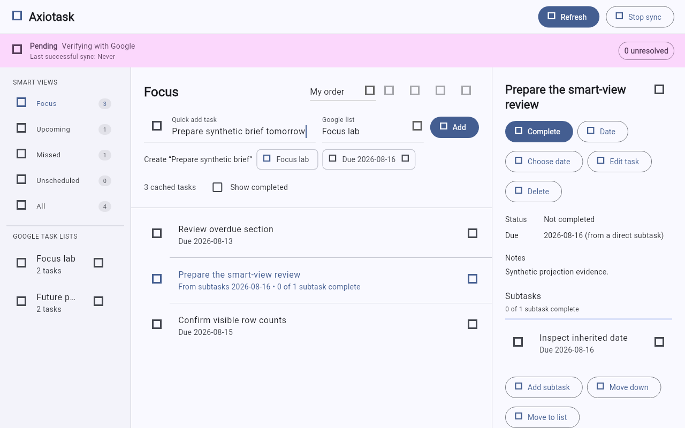

# Axiotask

Axiotask is a native Google Tasks client built with Flutter. It makes everyday
task management faster with quick capture, search, smart views, and bulk actions.
You can keep working offline and see whether your changes have reached Google.

Linux (Fedora GNOME) is the current focus. Android support is in development.

<picture>
  <source media="(prefers-color-scheme: dark)" srcset="test/goldens/linux/quick_capture_dark.png">
  <source media="(prefers-color-scheme: light)" srcset="test/goldens/linux/quick_capture_light.png">
  
</picture>

*Quick capture, smart views, and task details with synthetic demo data.*

## Build on Linux

Install [Flutter 3.44.8](https://docs.flutter.dev/install/archive), add its `bin`
directory to `PATH`, and install the Fedora dependencies:

```bash
sudo dnf install git clang cmake ninja-build pkgconf-pkg-config gtk3-devel \
  libsecret libsecret-devel gnome-keyring libstdc++-devel

flutter config --enable-linux-desktop
flutter doctor -v

git clone https://github.com/IllyaYalovyy/axiotask.git
cd axiotask
flutter pub get
./scripts/linux_app.sh build release
```

The Linux toolchain checks in `flutter doctor` must pass. On x86-64, the build
is in `build/linux/x64/release/bundle/`; keep the whole bundle together.

## Configure Google sign-in

Enable the Google Tasks API and create a **Desktop app** OAuth client in your
Google Cloud project ([Google setup guide](https://developers.google.com/workspace/tasks/quickstart/python#set_up_your_environment)).
Then copy the configuration template:

```bash
axiotask_config="${XDG_CONFIG_HOME:-$HOME/.config}/axiotask"
mkdir -p "$axiotask_config"
cp --no-clobber config/axiotask.example.toml "$axiotask_config/config.toml"
chmod 600 "$axiotask_config/config.toml"
```

Edit `client_id` and `client_secret` in that file (normally
`~/.config/axiotask/config.toml`). GNOME Keyring must be running and unlocked to
store sign-in credentials. Launch the app and choose **Connect** to sign in.

## Install and run

The installer builds a release and copies it into your home directory:

```bash
./scripts/linux_app.sh install release "$HOME/.local/opt/axiotask"
"$HOME/.local/opt/axiotask/axiotask"
```

The destination must not already exist. To uninstall, or before reinstalling:

```bash
./scripts/linux_app.sh remove "$HOME/.local/opt/axiotask"
```

To run directly from source, use `./scripts/linux_app.sh run`.

## Development

Run `./scripts/quality.sh` for the standard checks.
See [testing](docs/TESTING.md) and [architecture](docs/ARCHITECTURE.md) for details.
