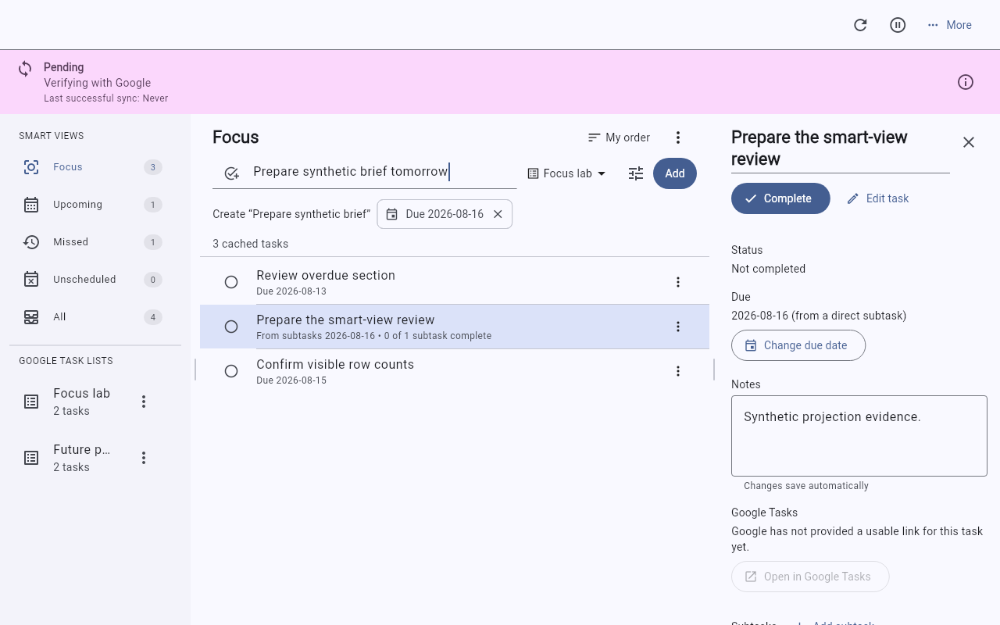

# Axiotask

Axiotask is a native Google Tasks client built with Flutter. It makes everyday
task management faster with quick capture, search, smart views, and bulk actions.
You can keep working offline and see whether your changes have reached Google.

Linux (Fedora GNOME) is the current focus. Android support is in development.

<picture>
  <source media="(prefers-color-scheme: dark)" srcset="test/goldens/linux/quick_capture_dark.png">
  <source media="(prefers-color-scheme: light)" srcset="test/goldens/linux/quick_capture_light.png">
  
</picture>

*Quick capture, smart views, and task details with synthetic demo data.*

## Build on Linux

Install [Flutter 3.50.0](https://docs.flutter.dev/install/archive), add its `bin`
directory to `PATH`, and install the Fedora dependencies:

```bash
sudo dnf install git clang cmake ninja-build pkgconf-pkg-config gtk3-devel \
  libsecret libsecret-devel gnome-keyring libstdc++-devel

flutter config --enable-linux-desktop
flutter doctor -v

git clone https://github.com/IllyaYalovyy/axiotask.git
cd axiotask
flutter pub get
./scripts/linux_app.sh build release
```

The Linux toolchain checks in `flutter doctor` must pass. On x86-64, the build
is in `build/linux/x64/release/bundle/`; keep the whole bundle together.

## Configure Google sign-in

Enable the Google Tasks API and create a **Desktop app** OAuth client in your
Google Cloud project ([Google setup guide](https://developers.google.com/workspace/tasks/quickstart/python#set_up_your_environment)).
Then copy the configuration template:

```bash
axiotask_config="${XDG_CONFIG_HOME:-$HOME/.config}/axiotask"
mkdir -p "$axiotask_config"
cp --no-clobber config/axiotask.example.toml "$axiotask_config/config.toml"
chmod 600 "$axiotask_config/config.toml"
```

Edit `client_id` and `client_secret` in that file (normally
`~/.config/axiotask/config.toml`). GNOME Keyring must be running and unlocked to
store sign-in credentials. Launch the app and choose **Connect** to sign in.

## Install and run

The installer builds a release and copies it into your home directory:

```bash
./scripts/linux_app.sh install release "$HOME/.local/opt/axiotask"
"$HOME/.local/opt/axiotask/axiotask"
```

The destination must not already exist. To uninstall, or before reinstalling:

```bash
./scripts/linux_app.sh remove "$HOME/.local/opt/axiotask"
```

To run directly from source, use `./scripts/linux_app.sh run`.
For downloadable CI builds, see [CI and artifacts](docs/CI.md).

### Android

Android uses Google Play Services authorization for Google Tasks and OpenID
account identity. Use the signed release APK on a device with Google Play
Services. Choose **Connect** in the synchronization status panel and approve
Google access. Subsequent launches restore authorization without prompting.
The desktop OAuth configuration file is not used on Android.

Local release builds require `android/key.properties` pointing to the OAuth-registered
signing keystore. Google Cloud must register the Android OAuth client for
`com.axiotask.app` and that certificate's SHA-1 fingerprint, with the Google Tasks
API enabled. A debug certificate needs its own registration.

```bash
flutter build apk --release
adb install -r build/app/outputs/flutter-apk/app-release.apk
```

Version 1.5.6 uses the historical OAuth-registered certificate with SHA-1
`92:0A:4B:DD:8D:D9:C4:83:08:F5:6F:5A:6B:AB:8B:5E:36:A3:AC:72`.
The v1.5.3–v1.5.5 GitHub APKs used a different, unregistered certificate. Android
requires uninstalling those APKs before installing 1.5.6; export any unsynced
local work first because uninstalling clears local app data. Google Tasks cloud
data remains available after connecting. Installations already signed with the
registered certificate can update in place.

## Development

Run `./scripts/quality.sh` for the standard checks.
See [testing](docs/TESTING.md) and [architecture](docs/ARCHITECTURE.md) for details.

Licensed under [GPL-3.0-or-later](LICENSE).
